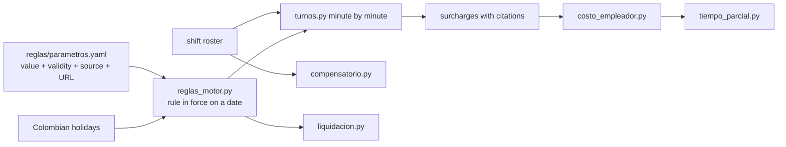

# Nómina Clara

[Español](README.md) · **English**

Computes surcharges, overtime, compensatory rest days, total employer cost and contract
settlement under Colombian labor law, **with every peso explained**: which rule applied, since
when, which legal norm it comes from, and whether that rule has already been checked against the
official text.

> Status: **v0.3** (engine). Employer view first; employee view next.
> **Not legal advice.** Every citation links to the official text.

## The problem

Laws 2466 of 2025 and 2101 of 2021 change the rules on staggered dates:

| Rule | Change | From | Status |
|---|---|---|---|
| Start of night work | 9 p.m. → 7 p.m. | 25-Dec-2025 | verified (Law 2466, art. 10) |
| Sunday/holiday surcharge | 75 % → 80 % → 90 % → 100 % | Jul-2025 / Jul-2026 / Jul-2027 | verified (Law 2466, art. 14) |
| Habitual Sunday work | 3+ mandatory rest days in the month | Law 2466 | verified |
| Overtime caps | 2 h/day, 12 h/week | Law 2466 | verified (art. 13) |
| Max weekly hours | 47 → 46 → 44 → 42 h | 2023 to 2026 | values verified |

The same shift is paid differently depending on its date, so the engine evaluates **every minute
with the rule in force that day**.

## What v0.3 includes

- **Traceable rules** (`reglas/parametros.yaml`): value, validity window, source, status, norm,
  article, official URL, consultation date and literal quote — 36 rules. No legal value is hard-coded in Python.
- **Surcharges and overtime** minute by minute (`turnos.py`), split by component (night, overtime,
  Sunday) with daily/weekly cap alerts.
- **Compensatory rest** (`compensatorio.py`): occasional vs. habitual, value and liability.
- **Part-time and hourly work** (`tiempo_parcial.py`): proportional minimum wage and weekly contributions (Decree 2616/2013).
- **Employer cost** (`costo_empleador.py`): contributions, art. 114-1 exemption, IBC cap and exact provisions.
- **Contract settlement** (`liquidacion.py`): severance, interest, bonus, vacation and art. 64 indemnity
  for indefinite, fixed-term and per-project contracts; art. 65 late-payment penalty.

## Run it

```bash
pip install -e ".[dev]"
python -m pytest -q                              # 72 tests
python ejemplos/tiempo_parcial_dominicales.py
python ejemplos/liquidacion_despido.py           # dismissal without just cause, variable salary
python ejemplos/rotativo_noviembre.py            # security guard on rotating shifts
```

## Architecture



## Traceability

`verificado` means the value and validity were read from a primary source (Función Pública,
Constitutional Court, UGPP…) on the recorded date; the loader rejects a "verified" rule without
URL and date. Each result line carries its citations (`regla.cita()` / `regla.cita_completa()`).

Docs (Spanish): [rule verification](docs/verificacion_reglas.md) · [assumptions](docs/supuestos.md) ·
[decisions](docs/decisiones.md) · [AI usage](docs/uso_de_ia.md)

---
Personal portfolio project by **Johan Esteban García Bautista** · MIT License
