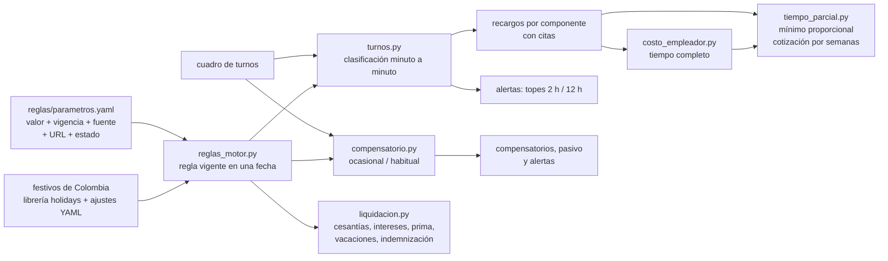

# Nómina Clara

**Español** · [English](README.en.md) · [Ficha en el portafolio](https://johangb.github.io/proyectos/nomina-clara.html)

  

Calcula recargos, horas extra, descansos compensatorios, el costo laboral total y la liquidación del contrato en Colombia,
**con cada peso explicado**: qué regla se aplicó, desde cuándo rige, de qué norma sale y si esa
regla ya se contrastó con el texto oficial.

> Estado: **v0.3** (motor). Vista del empleador primero; la del trabajador vendrá después.
> **No es asesoría jurídica.** Cada cita enlaza el texto oficial; revíselo antes de un caso real.

## Qué resuelve
La Ley 2466 de 2025 y la Ley 2101 de 2021 cambian las reglas en fechas escalonadas:

| Regla | Cambio | Desde | Estado |
|---|---|---|---|
| Inicio del trabajo nocturno | 9 p. m. → 7 p. m. | 25-dic-2025 | verificado (Ley 2466, art. 10) |
| Recargo dominical/festivo | 75 % → 80 % → 90 % → 100 % | 1-jul-2025 / 1-jul-2026 / 1-jul-2027 | verificado (Ley 2466, art. 14) |
| Trabajo dominical habitual | 3 o más días de descanso obligatorio en el mes | Ley 2466 | verificado (art. 14, par. 1) |
| Topes de horas extra | 2 h diarias / 12 h semanales; seguridad y salud exceptuados | Ley 2466 | verificado (art. 13) |
| Jornada máxima semanal | 47 → 46 → 44 → 42 h | 15-jul 2023 a 2026 | valores verificados; falta la fecha de publicación |

Un mismo turno se paga distinto según su fecha. El motor evalúa **cada minuto con la regla vigente ese día**.

## Qué hay en v0.3
- **Reglas con trazabilidad** (`reglas/parametros.yaml`): valor, vigencia, fuente, estado,
  norma, artículo, URL del texto oficial, fecha de consulta y cita textual. En v0.3 hay 36 reglas;
  las 6 nuevas de liquidación y 2 que estaban pendientes (intereses de cesantías y auxilio en la base)
  quedaron `verificado`. El resto queda `por_verificar`, con el enlace exacto
  ([verificacion_reglas.md](docs/verificacion_reglas.md)).
- **Recargos y horas extra** minuto a minuto (`turnos.py`), con los recargos separados por
  componente (nocturno, extra, dominical) y alertas de topes diarios y semanales.
- **Descanso compensatorio** (`compensatorio.py`): clasifica el mes como ocasional o habitual,
  calcula los compensatorios que se generan, su valor y el pasivo si el cuadro no los otorga, y
  alerta los que vencen fuera del cuadro.
- **Tiempo parcial y por horas** (`tiempo_parcial.py`): mínimo proporcional, valor hora,
  auxilio proporcional, prestaciones y **cotización por semanas** (Decreto 2616 de 2013).
- **Costo del empleador** (`costo_empleador.py`): aportes, exoneración del art. 114-1 ET, tope
  del IBC y provisiones exactas (días/360).
- **Liquidación del contrato** (`liquidacion.py`, nuevo en v0.3): cesantías con la base del art. 253
  (último salario o promedio si varió), intereses del 12 %, prima del semestre, vacaciones compensadas
  (Ley 995 de 2005) e indemnización del art. 64 para contratos indefinidos, a término fijo y por obra.
  Aparte, la indemnización moratoria del art. 65. Todas sus reglas están `verificado`, salvo la
  convención de 360 días.

## Cómo ejecutarlo
Requiere Python 3.10+ (probado en Linux; pensado para Windows 11: rutas con `pathlib`, archivos
en UTF-8 y salida segura en consola cp1252).

```bash
pip install -e ".[dev]" && python -m pytest -q && python ejemplos/tiempo_parcial_dominicales.py
```

Otros ejemplos: `python ejemplos/liquidacion_despido.py` (despido sin justa causa con salario variable)
y `python ejemplos/rotativo_noviembre.py` (vigilante en turno rotativo).

## Arquitectura


## Trazabilidad
- Las reglas son **datos versionados**, no código. Ningún valor legal está escrito en Python.
- `verificado` significa que el valor y la vigencia se leyeron en el texto oficial o en una compilación
  institucional (Senado, Función Pública, Colpensiones) en la fecha `consultado`; **no se contrastaron
  contra el Diario Oficial**. El cargador rechaza una regla `verificado` sin URL ni fecha.
- Cada línea de resultado lleva sus citas: `regla.cita()` es la corta y `regla.cita_completa()`
  agrega la URL y el fragmento literal.

## Limitaciones

- No todas las reglas están verificadas: las que no, quedan como `por_verificar` con el enlace exacto a su fuente.
- Revisión del 16-nov-2026: de las 36 reglas, 8 siguen `por_verificar`. En 4 de ellas (inicio nocturno, recargo dominical y festivo,
  tope de horas extra y festivo de la Virgen de Chiquinquirá) el texto oficial se leyó y **no coincide con la fecha de vigencia** del YAML;
  en los 4 el valor coincide y solo difiere la fecha. El YAML no se ha cambiado hasta que el autor confirme; el detalle está en
  [`docs/verificacion_reglas.md`](docs/verificacion_reglas.md) (revisión del 16-nov-2026).
- Versión 0.3: por ahora solo la vista del empleador; la del trabajador vendrá después.
- No es asesoría jurídica. Cada cita enlaza el texto oficial; revíselo antes de un caso real.

Documentos: [verificación de reglas](docs/verificacion_reglas.md) · [supuestos](docs/supuestos.md) ·
[decisiones](docs/decisiones.md) · [uso de IA](docs/uso_de_ia.md)
